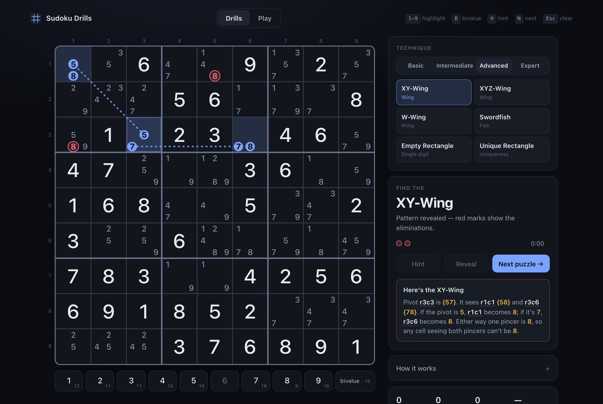
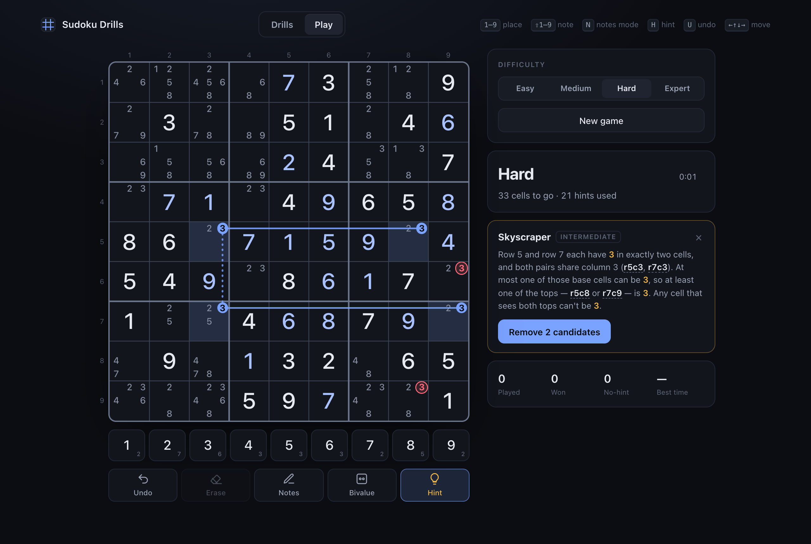
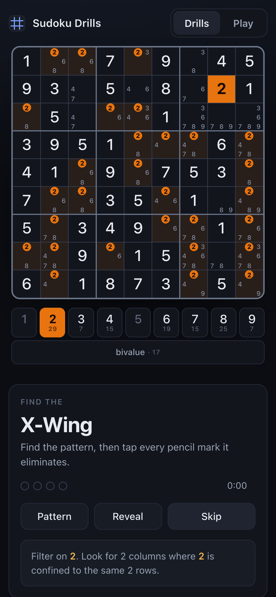

# Sudoku Drills

Practice specific sudoku solving techniques the way chess players drill tactics — and play full games with hints that explain the next logical step.

**Live:** https://longkutoy.com/sudoku-puzzle/



## Features

### Drills
Pick a technique and get a freshly generated puzzle where that technique is **the next logical move** — every easier technique has already been exhausted, and the pattern appears exactly once. Find it, then tap every pencil mark it eliminates.

| Level | Techniques |
|---|---|
| Basic | Pointing, Box/Line Reduction, Naked Pair, Hidden Pair |
| Intermediate | Naked Triple, Hidden Triple, X-Wing, Skyscraper, 2-String Kite |
| Advanced | XY-Wing, XYZ-Wing, W-Wing, Swordfish, Empty Rectangle, Unique Rectangle |
| Expert | Finned X-Wing, Simple Coloring, XY-Chain |

Pencil marks are pre-filled, digit highlighting and a bivalue-cell toggle help you scan, and two-stage hints (nudge → pattern) are there if you're stuck. On solve or reveal, the pattern is drawn on the board with a plain-English explanation.

### Play
Full games at **Easy / Medium / Hard / Expert**, generated fresh and graded by the same logical solver — every puzzle has a unique solution and can be finished without guessing.



- **Hints at any point:** technique name + nudge → highlighted pattern + explanation → apply. Hints also catch a wrong digit or a pencil mark you removed by mistake.
- Auto pencil marks, notes mode, undo, mistake tracking, and progress saved in the browser.
- The win screen lists the techniques the puzzle needed.



## How it works

Everything lives in [`public/engine.js`](public/engine.js):

1. **Generate** a random solved grid, then remove clues until it's a minimal puzzle with a unique solution (bitmask backtracking solver).
2. **Solve logically** with a ranked list of techniques, easiest first — the solver always applies the easiest step available.
3. **Drills:** apply everything easier than the target until stuck; if the target applies (and only once), that's the drill. Otherwise advance with a harder technique and look again.
4. **Games:** the difficulty is the hardest technique the solver needed; easier games get clues added back while staying in their band.
5. **Hints** run the same solver on the player's current board.

Every elimination is checked against the known solution during generation. No dependencies, no build step — plain HTML, CSS and JavaScript.

## Run locally

```bash
python3 -m http.server 5173 --directory public
```

Then open http://localhost:5173. (Opening `public/index.html` directly also works.)

## Deploy

[`deploy.sh`](deploy.sh) syncs `public/` to S3 under `sudoku-puzzle/` (only that prefix is touched) with `Cache-Control: no-cache`, then invalidates the CloudFront cache.

```bash
./deploy.sh            # deploy
./deploy.sh --dryrun   # preview changes only
```

Override `BUCKET`, `PREFIX`, `DOMAIN` or `AWS_PROFILE` via environment variables.
